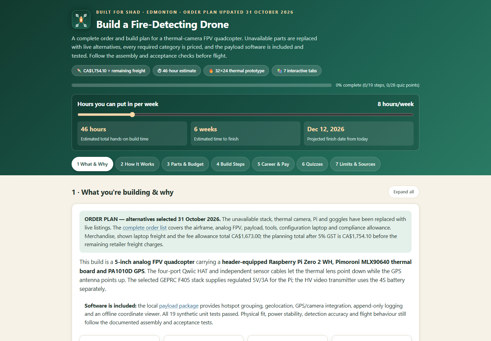
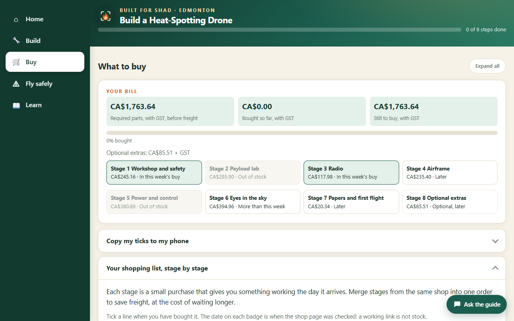
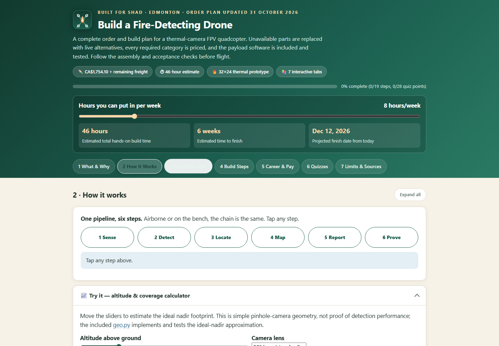
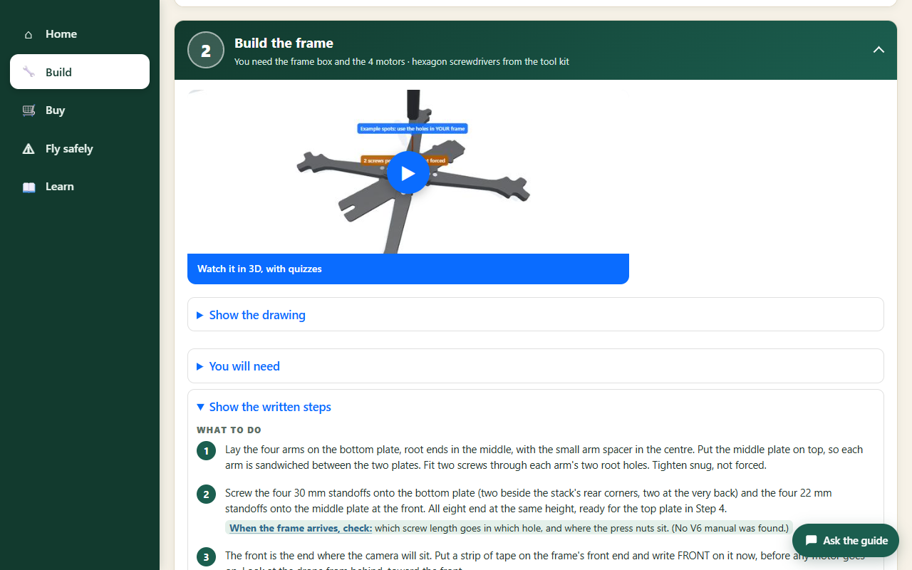
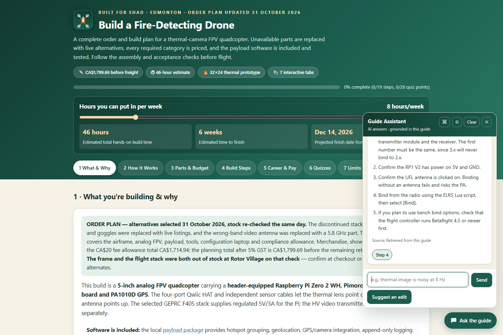
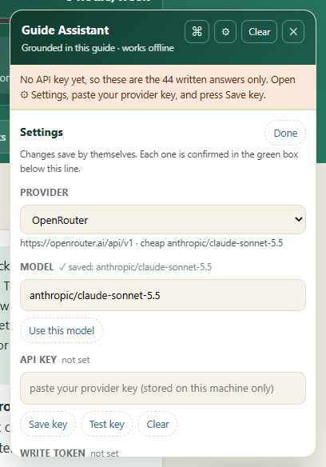
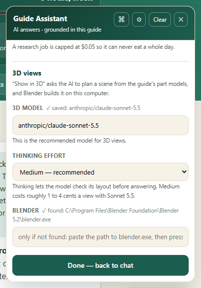
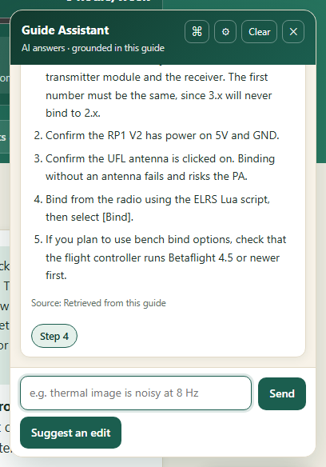
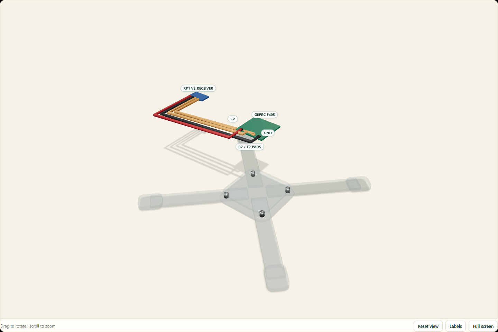
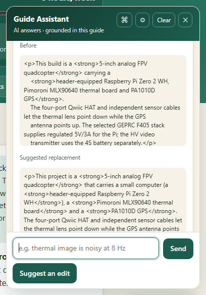

# Shad's Heat-Spotting Drone Build Guide

## [▶ Open the Interactive HTML Guide](https://albertancoder.github.io/build-guide/)

**Quick links:** [Live guide](https://albertancoder.github.io/build-guide/) · [HTML source file](index.html) · [Exact order list](Shad-Drone-Order-List.md) · [Audit report](Shad-Drone-Audit-Report.md) · [Payload software](Shad-Drone-Payload/)

A single-page, interactive order and build guide for a 5-inch analog FPV quadcopter with a Raspberry Pi thermal/GPS payload.

This is a learning and portfolio project: the wildfire part is a simulation plus tests on safe heat targets, because the law keeps drones out of real wildfire airspace (CAR 601.15).

## Preview

### Main page and 46-hour build-time calculator

[](docs/images/overview.png)

### Parts and interactive budget

The guide has five places: **Home**, **Build**, **Buy**, **Fly safely** and **Learn** (a left sidebar on a
laptop, a bar along the bottom on a phone). **Home** shows where you are, the hours and "money I can spend
this week" sliders, and three doors: Buy today, When a parcel arrives, Before you fly. **Buy** shows
**Your bill** (the required parts with GST, bought so far, still to buy, a progress bar, and the optional
extras on their own line), the **Buy today** list and every
part by stage. Every line has a shop link, a dated stock badge and a backup place to buy it (or an honest "none
found"). The required parts are CA$1,680.63 before GST and freight (CA$1,763.64 with GST), bought in seven small stages that each
give you something working the day they arrive. All the money on the page comes from one list (the
`buy-data` block in `index.html`).

[](docs/images/order-plan.png)

### Detection pipeline and coverage calculator

[](docs/images/logic.png)

### IKEA-style assembly instructions

Open **4 Build Steps** in the guide for the assembly manual: one step at a time, each with
its interactive 3D model and flat picture, a parts strip, numbered actions, a safety note
and a check gate before the next step. Big Previous/Next buttons walk through the eight
steps — inventory, frame assembly, soldering, receiver/FPV wiring, charging, Pi/sensor
wiring, payload mounting and testing — or a toggle shows all eight at once.

[](docs/images/illustrated-build.png)

The individual SVG diagrams are also available in `docs/images/build/`.

### Interactive 3D models

Each of the eight steps — plus the finished aircraft — is an interactive 3D model you can
orbit, zoom and pan, with HTML part labels read from the model itself. three.js is vendored in
`docs/vendor/three` (no CDN), models are lazy-loaded on scroll, and each step also shows its
flat picture underneath the model. Step 8's six test stages are clickable hotspots
(A–F) that highlight the hardware each stage exercises.

Models are generated from committed Blender scripts, so they can be rebuilt at any time:

```bash
blender -b --factory-startup -P scripts/build/build_step02_frame.py
blender -b --factory-startup -P scripts/build/build_final_product.py   # etc.
```

| File | Purpose |
|---|---|
| `scripts/build/lib_core.py` | materials, explicit-mesh primitives, label anchors, GLB export, preview render |
| `scripts/build/lib_quad.py` | the quad itself: frame, motors, propellers, stack, payload, battery |
| `scripts/build/lib_kit.py` | bench hardware: radio, charger, LiPo bag, smoke stopper, monitor, laptop, tools |
| `scripts/build/build_*.py` | one builder per model |
| `docs/models/*.glb` | exported models (all under 7k triangles) |
| `docs/js/viewer3d.js` | on-demand viewer: orbit/zoom/pan, CSS2D labels, hotspots, shadow catcher |

Labels travel inside the GLB as node `extras`, so a model and its labels can never drift apart.
To view locally, serve the repo root (ES modules and GLB fetches need HTTP):

```bash
python -m http.server 8000
```

### Opening the guide by double-click (no server)

Browsers block ES modules and `.glb` fetches on `file://`, so opening `index.html` directly shows
the page but no 3D. For a double-clickable copy, build the self-contained single file instead —
three.js, all nine models, every diagram and the Guide Assistant get inlined, and the result works
from any folder:

```bash
# once, in a scratch dir: npm install esbuild
esbuild docs/js/viewer3d.js --bundle --format=iife --minify --target=es2020 \
  --alias:three=./docs/vendor/three/build/three.module.js \
  --alias:three/addons/controls/OrbitControls.js=./docs/vendor/three/addons/controls/OrbitControls.js \
  --alias:three/addons/loaders/GLTFLoader.js=./docs/vendor/three/addons/loaders/GLTFLoader.js \
  --alias:three/addons/renderers/CSS2DRenderer.js=./docs/vendor/three/addons/renderers/CSS2DRenderer.js \
  --outfile=bundle.js

node scripts/standalone/make-standalone.js bundle.js "Shad's Build Guide.html"
```

Every place and page is deep-linkable: `#p-steps` (or `#steps`) opens Build, `#parts` opens Buy, `#fly`
opens Fly safely and `#plan` opens Learn > Plan. With no link, a first visit opens on Home; after that the
guide reopens the place you were last on.

### Keeping prices honest, and checking links

The public page cannot check shops live, so every price and stock note is a dated snapshot and turns red
after 3 days. Refresh it before you buy (Node only, no installs):

```
node scripts/standalone/refresh-stock.js            # check only: print what each shop says
node scripts/standalone/refresh-stock.js --write    # write status, stock note and date into index.html
node scripts/standalone/check-links.js              # does every link on the page open?
```

Walmart, Amazon, Canadian Tire and GetFPV block scripts: open those by hand (the date on the badge says when a
person last did). A price that differs from the file is printed as a MISMATCH; the script never changes a price itself.

### Install it as an app, and use it offline

Run `Start Guide Assistant.cmd` (or `node server/assistant-server.js`), open http://localhost:8790/ once in
Chrome or Edge, and press **Install app** in the page header. The guide, the 3D models and the pictures then open with
no network. The page text itself is fetched fresh whenever you are online. Shop prices are never cached on their own:
an old offline copy shows its "checked N days ago" warning. (`sw.js` is the service worker; change `CACHE` in it to
force every device to refresh.)

```
python scripts/standalone/make-icons.py [logo.svg]   # rebuild docs/icons/ (192, 512, maskable, .ico) from a logo
powershell -ExecutionPolicy Bypass -File scripts\standalone\make-shortcut.ps1   # Desktop shortcut with the icon
node scripts/standalone/check-offline-list.js        # every file the page needs is in the offline list
```

### Guide Assistant (an AI that answers from this guide)

A chat panel in the bottom-right corner (**Ask the guide**) answers questions about *this* build,
streams the answer, and links straight to the tab or assembly step it used. It can also draw a new
3D view of anything you are stuck on, and suggest an edit to a guide paragraph, with every claim
backed by an exact quote from the guide.

[](docs/images/guide-with-assistant.png)

#### The localhost page

`http://localhost:8790/` is the whole guide, served from your own computer by a small Node server
(`server/assistant-server.js`), with the AI switched on:

- **The guide itself:** the five places (Home, Build, Buy, Fly safely, and Learn with its pages What & Why,
  How it works, Plan, Career & pay, Quizzes, Limits & sources), the build-time calculator, the eight-step assembly manual and its
  interactive 3D models. Progress and quiz scores are kept in your browser.
- **Ask the guide** (bottom right) opens the assistant. Its header buttons are **⌘** for past
  conversations (kept on this computer and restored on reload), **⚙** for Settings, **Clear** for a
  fresh chat and **✕** to close it. Under the message box: **Send** asks a question,
  **Suggest an edit** proposes a change to the tab you are on, and **Show in 3D** makes a 3D view of
  whatever you type.
- **[localhost:8790/review](http://localhost:8790/review)** lists the edit proposals you accepted,
  each with its change shown side by side, waiting for you to apply or discard.

Your API key, settings, conversations and 3D views stay in git-ignored folders under `server/`.
Nothing leaves the machine except the questions sent to the AI provider you chose.

#### Set it up (about 5 minutes, Windows)

1. **Install Node.js.** Download the LTS version from [nodejs.org](https://nodejs.org/) and run the
   installer with its defaults. Nothing else needs installing: the server has no dependencies.
2. **Get the code.** Either `git clone https://github.com/AlbertanCoder/build-guide.git`, or use
   **Code → Download ZIP** on GitHub and unzip it.
3. **Start it.** Double-click **`Start Guide Assistant.cmd`** in the repo folder. It starts the local
   server (a minimised window called "Guide Assistant server") and opens
   [http://localhost:8790/](http://localhost:8790/). The same thing by hand:

   ```powershell
   node server/assistant-server.js --allow-write   # then open http://localhost:8790/
   ```

   Use that address, not a double-clicked `.html` file: the double-clickable copy is offline-only
   and cannot hold a key. Closing the server window turns the AI off until you start it again.
4. **Optional, for Show in 3D: install Blender.** Download it free from
   [blender.org](https://www.blender.org/download/) and install it with its defaults. The server
   finds it by itself (Settings shows **✓ found**). Everything else works without it.

#### Add your API key

[](docs/images/assistant-settings.png)

1. **Get a key.** [OpenRouter](https://openrouter.ai/settings/keys) is the recommended choice: one
   key reaches Claude, GPT, Gemini and others. Create a key, give it a credit limit (for example
   $5 a week), and add a few dollars of credit at
   [openrouter.ai/settings/credits](https://openrouter.ai/settings/credits); a limit does not add
   credit by itself. For a free tier, use [Groq](https://console.groq.com/keys) instead.
2. Open the guide at `http://localhost:8790/`, click **Ask the guide**, then the **⚙** button.
3. **Provider:** choose OpenRouter (or Groq).
4. **Model:** click the box and start typing, e.g. `sonnet`. Once a key is saved, it suggests
   matching names from every model that key can use, fetched from the provider (a free call).
   Picking a suggestion saves it straight away; for a name that is not suggested, type it in full
   and press Enter or **Use this model**. For the best suggestions on OpenRouter, use
   `anthropic/claude-sonnet-5.5`.
5. **API key:** paste the key, press **Save key**, then **Test key**. "The provider accepted the
   key" means you are done; the header changes to *AI answers · grounded in this guide*.
6. **Daily budget:** set a cap (for example $0.50). When it is reached the assistant switches back
   to its built-in answers instead of spending more.
7. **3D views** (near the bottom of Settings) have their own model and thinking effort, because
   placing parts in space is harder than answering from text. Recommended:
   `anthropic/claude-sonnet-5.5` with **Medium** thinking, about 2 cents a view (measured). A cheaper
   answer model such as DeepSeek or Haiku can stay on for questions. Leave the 3D model empty to use
   the answer model, and choose **High** only if layouts come out muddled.
8. Press **Done** (top or bottom of Settings, or Esc) to go back to the chat. There is nothing else
   to save: every change saves itself, and the green box at the top of Settings confirms it. The
   Model line shows **✓ saved** with the model in use.

[](docs/images/assistant-3d-settings.png)

The key is stored only on this machine, in `server/.settings.json`, which git ignores; the page
only ever sees its last four characters. No key and no money? Choose **Ollama** as the provider and run a local model.

#### Use it

[](docs/images/assistant-answer.png)

- **Ask anything about the build** — parts, wiring, a fault, what to buy first. Answers come from
  the guide's own text and the curated troubleshooting set, with a source line and buttons that
  jump to the step used.
- **General questions** (learning Python, how I2C works) get a short answer clearly labelled
  *General knowledge, not from this guide*.
- **Prices and regulations** are only stated with the date the guide checked them; otherwise it
  points you to the Parts tab. Five safety bans (detection claims, undated prices, flying near
  wildfires, certification claims, unapproved edits) are enforced in code, not just requested.
- **Show in 3D, when a step does not make sense:** press **Show this in 3D** under any AI answer,
  or type what you want to see ("where the receiver wires go", "which way the thermal lens faces")
  and press **Show in 3D**. In about 10 to 30 seconds a new interactive model appears in the chat,
  built from the same part models as the guide's own steps and labelled with the guide's real pad
  and part names. Drag to rotate, scroll to zoom, and press **Full screen** for a proper look. Old
  views reopen from the conversation with **Open 3D view**.

[](docs/images/assistant-3d-full.png)

  How it stays safe: the AI never writes code. It returns a scene plan, which is a list of the
  guide's own parts, plus simple boxes, wires, arrows and labels. The server keeps only the entries
  on an allowed list, and the fixed Blender script `scripts/build/build_from_plan.py` checks them
  again before building. The last 30 views are kept in `server/.renders/`.
- **Suggest an edit:** open the tab you want to improve, type what to change ("make the opening
  paragraph clearer for a beginner") and press **Suggest an edit**. You get a proposed paragraph
  plus a report of what improves, what the guide supports, and any conflicts, each with exact
  quotes. Occasionally a suggestion is refused by the checks; just ask again.

[](docs/images/assistant-suggestion.png)

- **Accept** creates a proposal branch only; the real guide does not change. **Reject** discards
  it without any network call. Review open proposals at
  [http://localhost:8790/review](http://localhost:8790/review), then apply or discard one:

  ```powershell
  node server/ops/accept.js proposal/<name>   # runs the full test gate, merges only if green, rebuilds
  node server/ops/reject.js proposal/<name>   # deletes the branch; main is never touched
  node server/ops/undo.js                     # reverts the last accepted change and rebuilds
  ```

**Grounding is enforced, not requested.** Every request carries passages retrieved from the guide
plus curated troubleshooting entries for the exact parts ordered; build answers must come from
them, general knowledge is labelled as such, and the five bans are checked on every answer before
it is shown or cached. If the AI service fails, the assistant says so instead of guessing.

**Troubleshooting:** *"No local server"* means you opened a file instead of
`http://localhost:8790/`, or the server window is closed: double-click `Start Guide Assistant.cmd`.
*"No API key yet"* means step 5 above has not been done. A credit or billing error on Test key
means the provider account needs credit.

For the public site, publish the repo root on **Cloudflare Pages** and deploy
`docs/assistant/worker.js` to Cloudflare Workers (Pages cannot run
Node) and point the page at it. Everything — routes, costs, the evaluation checklist for trusting a
model — is in [docs/assistant/README.md](docs/assistant/README.md).

**It is built to be cheap as well as good.** Four layers, cheapest first: a repeat
question is replayed from a signature cache; the cheap tier answers by default and
the strong tier is reached only when a question needs it; passages are compressed
to the sentences that answer the question; and `DAILY_USD_MAX` puts a hard ceiling
on spend, falling back to the offline engine rather than billing past it.
`/api/stats` shows the real numbers. Everything is in
[docs/assistant/README.md](docs/assistant/README.md).

Run the tests:

```powershell
# Everything at once: 32 suites, 1749 named checks, one exit code.
node scripts/dev/gate.js
node scripts/dev/gate.js --quick    # skip the browser suite (needs Chrome)
node scripts/dev/gate.js --json     # machine-readable

# Or one suite at a time:
powershell -NoProfile -ExecutionPolicy Bypass -File scripts/dev/check-llm-path.ps1   # AI path, mock provider, no key
powershell -NoProfile -ExecutionPolicy Bypass -File scripts/dev/check-assistant.ps1 -Target "dist/Shad's Build Guide.html"
node scripts/dev/check-kb-prices.js          # every KB price must also appear in the guide
node scripts/dev/check-cost-engine.js        # cache, router, meter, compression (26 checks)
node scripts/dev/check-cost-path.js          # zero-cost repeat, cap, escalation (30 checks)
node scripts/dev/build-domain.js --check     # domain pack is current and every claim is sourced
node scripts/dev/check-settings.js           # key never returned, budget clamped, secrets never served (39 checks)
node scripts/dev/check-browser.js            # real Chrome: drawer clicks, quiz pass survival (28)
node scripts/dev/check-quiz-op.js            # the quiz-add operation: 29 checks, incl. refusals
node scripts/dev/check-prose-op.js           # the prose-rewrite operation: 38 checks, incl. refusals
node scripts/dev/check-bans.js              # the five code-enforced bans: 37 checks, none inert
node scripts/dev/check-corrections.js       # the corrections memory: 22 checks, reviewed and pure
node scripts/dev/check-write-gates.js      # the three write gates: 13 checks, each gate alone stops a write
```

*These are previews of the HTML guide, not a completed aircraft. Click any image to view it full-size.*

## Open the guide

Open `index.html` in a browser. Tabs, build checkboxes, progress, quizzes, flashcards, the coverage calculator, editable budget and persistent 46-hour build-time calculator work locally in the browser.

## Included documents

- `Shad-Drone-Order-List.md` — exact parts, quantities, live retailer links, prices, compatibility and cost breakdown.
- `Shad-Drone-Audit-Report.md` — A–G review, component substitutions, compatibility and validation results.
- `Shad-Drone-Payload/` — thermal hotspot grouping, geolocation, real/synthetic payload backends, offline coordinate viewer and unit tests.
- `shad-drone-icon.svg` — current favicon/header artwork.
- `docs/js/assistant.js` + `docs/assistant/` — the offline Guide Assistant, plus the optional Cloudflare Worker that lets a model draft answers from retrieved passages.

The unavailable stack, thermal camera and Pi were replaced with live alternatives, and this build uses a monitor, not goggles. Every shop page was re-checked on **3 November 2026**. Every link loads, but **a working link is not stock**: on that re-check the Pi kit, the 55° thermal camera, the frame and the GEPRC stack were out of stock at their main shop, so confirm availability and freight at checkout. The required parts cost **CA$1,680.63** (no laptop: it assumes you use your own), or **CA$1,763.64 after 5% GST**, before remaining retailer freight — roughly **CA$1,803–1,833 landed** (the same CA$40–70 freight allowance as before). Optional extras: CA$85.51 + GST.

## Payload setup

See `Shad-Drone-Payload/README.md` for wiring, power, installation and acceptance checks. Run the software tests before hardware integration:

```bash
cd Shad-Drone-Payload
python -m unittest -v test_drone_logic.py
python payload.py --demo
python payload.py --demo --serve
```

The viewer defaults to `http://127.0.0.1:8000` and the append-only log is `flight-log.jsonl`.

## Validation

`node scripts/dev/gate.js` runs every suite below with one exit code; its last full run (3 November 2026) passed every
suite. Checks per suite:

- The guide in a real browser: 29/29 (`scripts/dev/check-browser.js`: the settings drawer, the quiz pass-survival rule,
  all 10 pages render, the step prerequisite boxes are readable, no page errors).
- Guide Assistant self-tests: 24/24 on the served page and 24/24 in the offline single-file build, including that a
  confident curated question is answered with no model call and an unanswerable one is not.
- Guide Assistant AI path: 11/11 end to end against a mock streaming provider (`scripts/dev/check-llm-path.ps1`): SSE
  streaming reached the browser, markdown rendered as real lists, the `[[NAV]]` directive became a button and was
  stripped from the prose, retrieval ran before the model call, and an empty-passage request was rejected with `422`.
- Price guard: 4/4 (`scripts/dev/check-kb-prices.js`): every figure in the assistant's knowledge base also appears in
  the guide, the budget arithmetic closes (CA$1,660.29 × 5% = CA$83.01; CA$1,680.63 + CA$83.01 = CA$1,763.64), and the
  superseded CA$1,678.00 total is absent.
- Cost engine 27/27 (`scripts/dev/check-cost-engine.js`) and cost path 30/30 (`scripts/dev/check-cost-path.js`) against
  a mock provider: a repeat question made no upstream call, `/api/stats` accounted the spend, the daily cap returned
  `402` without calling the provider, and a cheap-tier refusal escalated once to the strong tier.
- Settings API 39/39, including that the server never serves its saved key or `.env`, answers only to this machine's
  host names, and refuses cross-site posts.
- The chat's memory and phone access (job 8): memory and phone 51/51 (`scripts/dev/check-memory.js`: what it remembers,
  step awareness, pairing a phone and its security, the monthly cap) and chat memory in a real browser 18/18
  (`scripts/dev/check-chat-memory.py`).
- The fresh-eyes fixes (4 Nov 2026): stages and parcels in a real browser 13/13 (`scripts/dev/check-fresh-eyes.py`: the Home card
  follows the stages before the steps; the parcel tests follow what was ticked bought; the threadlocker test).
- The edit and memory suites: conversation memory 29/29, write gates 13/13, the five bans 37/37, corrections memory
  22/22, propose loop 41/41, review API 20/20, per-item acceptance 18/18, suggest an edit 128/128, quiz operation 29/29,
  prose operation 38/38, job spec 8/8, drafter 15/15, build sync 23/23, encoding 3/3, domain pack 1/1.
- The 3D build: step models 493/493, 3D views 21/21, 3D viewer 178/178, design simulations 13/13, build verification
  190/190 (`scripts/build/verify_build.py`: 190 passed, 0 failed, 35 need the real parts in hand).
- `node --check` clean on `docs/js/assistant.js`, `server/assistant-server.js` and the mock provider.
- Outside the gate: 31/31 payload unit tests (`Shad-Drone-Payload`); demo, map health/API and viewer responses passed.
- Every order-document link resolves, but a working link is not stock: the frame and the GEPRC 50A
  stack were out of stock on the 31 Oct 2026 re-check.

Product availability, compatibility and performance must still be verified during assembly, bench testing and controlled flight testing. This is a prototype builder's roadmap, not career or legal advice.
