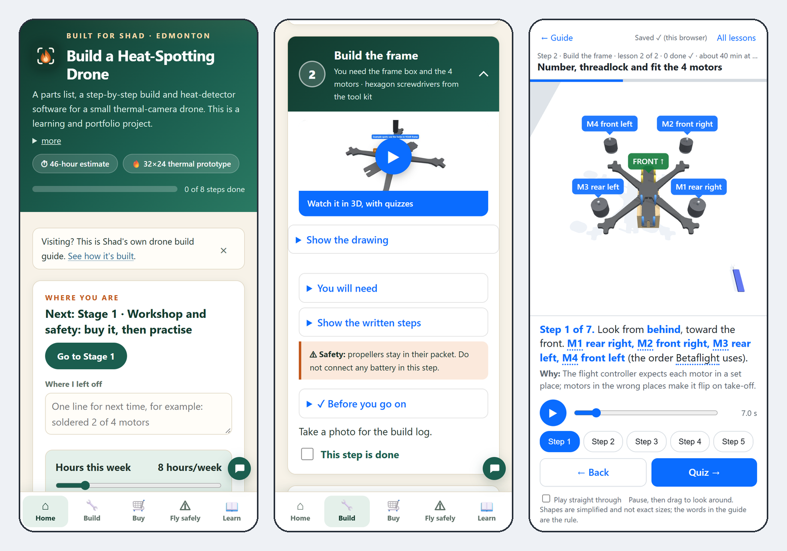
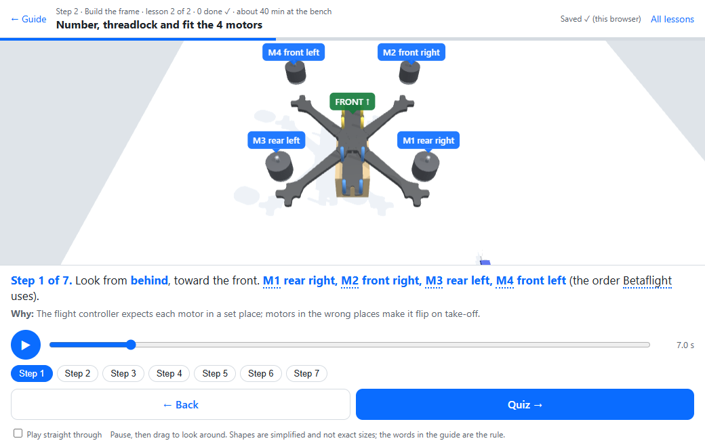

# Shad's Heat-Spotting Drone: a build guide you can follow

**[▶ Open the guide](https://albertancoder.github.io/build-guide/)** &nbsp;·&nbsp; works on a phone, a tablet and a desktop &nbsp;·&nbsp; nothing to install

[](https://albertancoder.github.io/build-guide/)

**On this page:** [What this is](#what-this-is) · [What is in it](#what-is-in-it) · [Try it](#try-it) · [How it was checked](#how-it-was-checked) · [For technical people](#for-technical-people)

## What this is

A step-by-step guide to building a small drone that carries a thermal camera and marks hot spots on a map.

- **Who made it:** Shad ([@AlbertanCoder](https://github.com/AlbertanCoder)), in Edmonton, working with AI coding tools.
- **Who it is for:** someone who has never built a drone. One action per line, plain words, a check before every next step.
- **What it is not:** a finished aircraft. The parts are bought in stages and the drone is not built yet. It is a learning and portfolio project.
- **The wildfire part is a simulation** plus tests on safe heat targets. The law keeps drones out of real wildfire airspace in Canada (CAR 601.15), and the guide says so.

## What is in it

| | |
|---|---|
| **Home** | Where you are, what to do next and what to buy next. |
| **Build** | One list, Step 0 (practice) to Step 8. Each step opens to a picture of its 3D lesson, a drawing, the written steps and a check before the next step. |
| **3D lessons** | 34 short lessons you can pause and turn around, with 35 quizzes (185 questions). They show which part goes where before you touch it. |
| **Buy** | 50 parts, each with a shop link and a dated stock check, and a backup shop where one was found. Bought in stages, so every parcel gives you something to do. |
| **Fly safely** | The Canadian rules for this drone, each with its official source: pilot certificate, registration, where you can fly, the radio licence for the video link. |
| **Learn** | Why it is built this way, how the heat detection works, the plan, and its limits. |

<a href="docs/images/guide-phone.png"></a>

**A 3D lesson** (pause it, drag to look around):

[](https://albertancoder.github.io/build-guide/docs/walkthrough/index.html#s2-motors)

**A build step** (one action per number, and a check wherever a part has to be looked at first):

[](https://albertancoder.github.io/build-guide/#p-steps)

**The Buy list** (every part with a dated stock check):

[](https://albertancoder.github.io/build-guide/#parts)

## Try it

1. Open **[albertancoder.github.io/build-guide](https://albertancoder.github.io/build-guide/)** on any phone or computer.
2. Tap **Build** to see the steps.
3. On any step, tap **Watch it in 3D**.

Your ticks and quiz passes stay in your own browser: the public site has no server behind it and loads nothing from other websites.

## How it was checked

Nothing in the guide is called "done" on trust. Before a release:

- every shop link is opened and its price and stock read again (last full read: 11 Nov 2026, 79 links);
- the law and "how the software works" statements are compared with their official sources as they read that day (124 statements on 11 Nov 2026);
- the design is checked by script: 243 fit, wiring, weight and clearance checks, the measured ones repeated 10,000 times with each size varied inside its accuracy (206 pass; 37 can only be settled with the real parts in hand);
- an automated gate runs 1749 named checks in 32 suites, in a real browser and on a phone-sized screen;
- every 3D lesson is played from start to end, and its pictures are looked at, on a desktop and on a phone.

What still needs the real parts is marked in the guide as a check to do when the part arrives. Nothing in the guide says the drone has flown.

---

## For technical people

### How it is built

- **One HTML page, no framework, no build step.** `index.html` holds the page, its styles and most of its scripts; the 3D viewer and the chat are plain script files in `docs/js/`. All the money on the page comes from one JSON block (`buy-data`); arrival tests, weights and the design-check summary are JSON blocks too.
- **3D:** [three.js](https://threejs.org/) is vendored in `docs/vendor/three` (no CDN). Nine `.glb` models in `docs/models/` are generated by committed Blender scripts in `scripts/build/`, so they can be rebuilt at any time. Labels travel inside each model as node `extras`, so a model and its labels can never drift apart.
- **3D lessons:** `docs/walkthrough/` is a small lesson player (`index.html`, `engine.js`) and one JavaScript module per lesson in `lessons/`. A lesson is a timeline: steps with their words, camera moves, labels and an `update(t)` function. Quizzes live in `lessons/index.js`. Progress is kept in the browser (the optional local server can hold it too, so two browsers share it).
- **Payload software:** `Shad-Drone-Payload/` (Python): hot-spot grouping on 32×24 thermal frames, pixel-to-ground geolocation, a simulated and a real backend, a small local map server, 31 unit tests.
- **Guide Assistant (optional, local):** `server/assistant-server.js`, a dependency-free Node server that serves the guide on `localhost:8790` and answers questions from the guide's own text through an AI provider of your choice. On the public site the chat has its built-in written answers only. Set-up is [further down](#the-guide-assistant-optional).
- **Works offline:** a service worker (`sw.js`) and a web-app manifest; a single-file copy (`Shad's Build Guide.html`) opens by double-click with the models inlined.

### Run it locally

```bash
git clone https://github.com/AlbertanCoder/build-guide.git
cd build-guide
python -m http.server 8000        # then open http://localhost:8000/
```

ES modules and `.glb` files need HTTP, so open it through a server, not as a file. Links that open a place directly: `#p-steps` (Build), `#parts` (Buy), `#fly`, `#plan`. The lessons are at `docs/walkthrough/index.html`; add `#<lesson-id>` to open one, for example `#s2-motors`.

### Repository map

| Path | What it is |
|---|---|
| `index.html` | the whole guide |
| `docs/walkthrough/` | the 3D lesson player, 34 lessons, the quizzes, a pretend radio to practise on |
| `docs/models/`, `scripts/build/` | the 3D models and the Blender scripts that build them |
| `scripts/build/verify_build.py` | the design check (fit, wiring, weight, tolerance runs) |
| `docs/build-truth/` | what each step's instruction is based on, and the check results |
| `docs/images/build/` | one flat drawing per build step (SVG) |
| `Shad-Drone-Payload/` | the payload software and its tests |
| `server/`, `docs/js/assistant.js`, `docs/assistant/` | the optional Guide Assistant |
| `scripts/dev/` | the test suites and `gate.js`, which runs them all |
| `scripts/standalone/` | single-file build, stock refresh, link check, icons |
| `Shad-Drone-Order-List.md`, `Shad-Drone-Audit-Report.md` | the earlier order plan and the first design review, as dated documents (the guide's Buy tab is the current list) |
| `docs/audit-2026-11-12/` | the independent audit of 12 Nov 2026 (`FINDINGS.md`: every line of the parts list checked against the shop pages) and what was fixed from it (`FIX-LOG.md`) |

### Rebuild the 3D models

```bash
blender -b --factory-startup -P scripts/build/build_step02_frame.py
blender -b --factory-startup -P scripts/build/build_final_product.py   # etc.
```

| File | Purpose |
|---|---|
| `scripts/build/lib_core.py` | materials, explicit-mesh primitives, label anchors, GLB export, preview render |
| `scripts/build/lib_quad.py` | the quad itself: frame, motors, propellers, stack, payload, battery |
| `scripts/build/lib_kit.py` | bench hardware: radio, charger, LiPo bag, smoke stopper, monitor, laptop, tools |
| `scripts/build/build_*.py` | one builder per model |
| `docs/models/*.glb` | exported models (all under 7k triangles) |
| `docs/js/viewer3d.js` | on-demand viewer: orbit/zoom/pan, CSS2D labels, hotspots, shadow catcher |

### The payload software

See `Shad-Drone-Payload/README.md` for wiring, power, installation and acceptance checks. Run the software tests before hardware integration:

```bash
cd Shad-Drone-Payload
python -m unittest -v test_drone_logic.py
python payload.py --demo
python payload.py --demo --serve
```

The viewer defaults to `http://127.0.0.1:8000` and the append-only log is `flight-log.jsonl`.

### Opening the guide by double-click (no server)

Browsers block ES modules and `.glb` fetches on `file://`, so opening `index.html` directly shows
the page but no 3D. For a double-clickable copy, build the self-contained single file instead —
three.js, all nine models, every diagram and the Guide Assistant get inlined, and the result works
from any folder:

```bash
# once, in a scratch dir: npm install esbuild
esbuild docs/js/viewer3d.js --bundle --format=iife --minify --target=es2020 \
  --alias:three=./docs/vendor/three/build/three.module.js \
  --alias:three/addons/controls/OrbitControls.js=./docs/vendor/three/addons/controls/OrbitControls.js \
  --alias:three/addons/loaders/GLTFLoader.js=./docs/vendor/three/addons/loaders/GLTFLoader.js \
  --alias:three/addons/renderers/CSS2DRenderer.js=./docs/vendor/three/addons/renderers/CSS2DRenderer.js \
  --outfile=bundle.js

node scripts/standalone/make-standalone.js bundle.js "Shad's Build Guide.html"
```

The 3D lessons are not in the single file: it shows a plain note in their place.

Every place and page is deep-linkable: `#p-steps` (or `#steps`) opens Build, `#parts` opens Buy, `#fly`
opens Fly safely and `#plan` opens Learn > Plan. With no link, a first visit opens on Home; after that the
guide reopens the place you were last on.

### Keeping prices honest, and checking links

The public page cannot check shops live, so every price and stock note is a dated snapshot and turns red
after 3 days. Refresh it before you buy (Node only, no installs):

```
node scripts/standalone/refresh-stock.js            # check only: print what each shop says
node scripts/standalone/refresh-stock.js --write    # write status, stock note and date into index.html
node scripts/standalone/check-links.js              # does every link on the page open?
```

Walmart, Amazon, Canadian Tire and GetFPV block scripts: open those by hand (the date on the badge says when a
person last did). A price that differs from the file is printed as a MISMATCH; the script never changes a price itself.

### Install it as an app, and use it offline

Run `Start Guide Assistant.cmd` (or `node server/assistant-server.js`), open http://localhost:8790/ once in
Chrome or Edge, and press **Install app** in the page header. The guide, the 3D models and the pictures then open with
no network. The page text itself is fetched fresh whenever you are online. Shop prices are never cached on their own:
an old offline copy shows its "checked N days ago" warning. (`sw.js` is the service worker; change `CACHE` in it to
force every device to refresh.)

```
python scripts/standalone/make-icons.py [logo.svg]   # rebuild docs/icons/ (192, 512, maskable, .ico) from a logo
powershell -ExecutionPolicy Bypass -File scripts\standalone\make-shortcut.ps1   # Desktop shortcut with the icon
node scripts/standalone/check-offline-list.js        # every file the page needs is in the offline list
```

### The Guide Assistant (optional)

A chat panel in the bottom-right corner (**Ask the guide**). On the public site it has its built-in written answers only. Run from your own computer with an AI key, it answers questions about this build from the guide's own text, can draw a new 3D view, and can suggest an edit to a paragraph with exact quotes from the guide.

<details>
<summary><strong>Set it up and use it</strong> (about 5 minutes, Windows)</summary>

A chat panel in the bottom-right corner (**Ask the guide**) answers questions about *this* build,
streams the answer, and links straight to the tab or assembly step it used. It can also draw a new
3D view of anything you are stuck on, and suggest an edit to a guide paragraph, with every claim
backed by an exact quote from the guide.

[](docs/images/guide-with-assistant.png)

#### The localhost page

`http://localhost:8790/` is the whole guide, served from your own computer by a small Node server
(`server/assistant-server.js`), with the AI switched on:

- **The guide itself:** the five places (Home, Build, Buy, Fly safely, and Learn with its pages What & Why,
  How it works, Plan, Career & pay, Quizzes, Limits & sources), the build-time calculator, the eight-step assembly manual and its
  interactive 3D models. Progress and quiz scores are kept in your browser.
- **Ask the guide** (bottom right) opens the assistant. Its header buttons are **⌘** for past
  conversations (kept on this computer and restored on reload), **⚙** for Settings, **Clear** for a
  fresh chat and **✕** to close it. Under the message box: **Send** asks a question,
  **Suggest an edit** proposes a change to the tab you are on, and **Show in 3D** makes a 3D view of
  whatever you type.
- **[localhost:8790/review](http://localhost:8790/review)** lists the edit proposals you accepted,
  each with its change shown side by side, waiting for you to apply or discard.

Your API key, settings, conversations and 3D views stay in git-ignored folders under `server/`.
Nothing leaves the machine except the questions sent to the AI provider you chose.

#### Set it up (about 5 minutes, Windows)

1. **Install Node.js.** Download the LTS version from [nodejs.org](https://nodejs.org/) and run the
   installer with its defaults. Nothing else needs installing: the server has no dependencies.
2. **Get the code.** Either `git clone https://github.com/AlbertanCoder/build-guide.git`, or use
   **Code → Download ZIP** on GitHub and unzip it.
3. **Start it.** Double-click **`Start Guide Assistant.cmd`** in the repo folder. It starts the local
   server (a minimised window called "Guide Assistant server") and opens
   [http://localhost:8790/](http://localhost:8790/). The same thing by hand:

   ```powershell
   node server/assistant-server.js --allow-write   # then open http://localhost:8790/
   ```

   Use that address, not a double-clicked `.html` file: the double-clickable copy is offline-only
   and cannot hold a key. Closing the server window turns the AI off until you start it again.
4. **Optional, for Show in 3D: install Blender.** Download it free from
   [blender.org](https://www.blender.org/download/) and install it with its defaults. The server
   finds it by itself (Settings shows **✓ found**). Everything else works without it.

#### Add your API key

[](docs/images/assistant-settings.png)

1. **Get a key.** [OpenRouter](https://openrouter.ai/settings/keys) is the recommended choice: one
   key reaches Claude, GPT, Gemini and others. Create a key, give it a credit limit (for example
   $5 a week), and add a few dollars of credit at
   [openrouter.ai/settings/credits](https://openrouter.ai/settings/credits); a limit does not add
   credit by itself. For a free tier, use [Groq](https://console.groq.com/keys) instead.
2. Open the guide at `http://localhost:8790/`, click **Ask the guide**, then the **⚙** button.
3. **Provider:** choose OpenRouter (or Groq).
4. **Model:** click the box and start typing, e.g. `sonnet`. Once a key is saved, it suggests
   matching names from every model that key can use, fetched from the provider (a free call).
   Picking a suggestion saves it straight away; for a name that is not suggested, type it in full
   and press Enter or **Use this model**. For the best suggestions on OpenRouter, use
   `anthropic/claude-sonnet-5.5`.
5. **API key:** paste the key, press **Save key**, then **Test key**. "The provider accepted the
   key" means you are done; the header changes to *AI answers · grounded in this guide*.
6. **Daily budget:** set a cap (for example $0.50). When it is reached the assistant switches back
   to its built-in answers instead of spending more.
7. **3D views** (near the bottom of Settings) have their own model and thinking effort, because
   placing parts in space is harder than answering from text. Recommended:
   `anthropic/claude-sonnet-5.5` with **Medium** thinking, about 2 cents a view (measured). A cheaper
   answer model such as DeepSeek or Haiku can stay on for questions. Leave the 3D model empty to use
   the answer model, and choose **High** only if layouts come out muddled.
8. Press **Done** (top or bottom of Settings, or Esc) to go back to the chat. There is nothing else
   to save: every change saves itself, and the green box at the top of Settings confirms it. The
   Model line shows **✓ saved** with the model in use.

[](docs/images/assistant-3d-settings.png)

The key is stored only on this machine, in `server/.settings.json`, which git ignores; the page
only ever sees its last four characters. No key and no money? Choose **Ollama** as the provider and run a local model.

#### Use it

[](docs/images/assistant-answer.png)

- **Ask anything about the build** — parts, wiring, a fault, what to buy first. Answers come from
  the guide's own text and the curated troubleshooting set, with a source line and buttons that
  jump to the step used.
- **General questions** (learning Python, how I2C works) get a short answer clearly labelled
  *General knowledge, not from this guide*.
- **Prices and regulations** are only stated with the date the guide checked them; otherwise it
  points you to the Parts tab. Five safety bans (detection claims, undated prices, flying near
  wildfires, certification claims, unapproved edits) are enforced in code, not just requested.
- **Show in 3D, when a step does not make sense:** press **Show this in 3D** under any AI answer,
  or type what you want to see ("where the receiver wires go", "which way the thermal lens faces")
  and press **Show in 3D**. In about 10 to 30 seconds a new interactive model appears in the chat,
  built from the same part models as the guide's own steps and labelled with the guide's real pad
  and part names. Drag to rotate, scroll to zoom, and press **Full screen** for a proper look. Old
  views reopen from the conversation with **Open 3D view**.

[](docs/images/assistant-3d-full.png)

  How it stays safe: the AI never writes code. It returns a scene plan, which is a list of the
  guide's own parts, plus simple boxes, wires, arrows and labels. The server keeps only the entries
  on an allowed list, and the fixed Blender script `scripts/build/build_from_plan.py` checks them
  again before building. The last 30 views are kept in `server/.renders/`.
- **Suggest an edit:** open the tab you want to improve, type what to change ("make the opening
  paragraph clearer for a beginner") and press **Suggest an edit**. You get a proposed paragraph
  plus a report of what improves, what the guide supports, and any conflicts, each with exact
  quotes. Occasionally a suggestion is refused by the checks; just ask again.

[](docs/images/assistant-suggestion.png)

- **Accept** creates a proposal branch only; the real guide does not change. **Reject** discards
  it without any network call. Review open proposals at
  [http://localhost:8790/review](http://localhost:8790/review), then apply or discard one:

  ```powershell
  node server/ops/accept.js proposal/<name>   # runs the full test gate, merges only if green, rebuilds
  node server/ops/reject.js proposal/<name>   # deletes the branch; main is never touched
  node server/ops/undo.js                     # reverts the last accepted change and rebuilds
  ```

**Grounding is enforced, not requested.** Every request carries passages retrieved from the guide
plus curated troubleshooting entries for the exact parts ordered; build answers must come from
them, general knowledge is labelled as such, and the five bans are checked on every answer before
it is shown or cached. If the AI service fails, the assistant says so instead of guessing.

**Troubleshooting:** *"No local server"* means you opened a file instead of
`http://localhost:8790/`, or the server window is closed: double-click `Start Guide Assistant.cmd`.
*"No API key yet"* means step 5 above has not been done. A credit or billing error on Test key
means the provider account needs credit.

For the public site, publish the repo root on **Cloudflare Pages** and deploy
`docs/assistant/worker.js` to Cloudflare Workers (Pages cannot run
Node) and point the page at it. Everything — routes, costs, the evaluation checklist for trusting a
model — is in [docs/assistant/README.md](docs/assistant/README.md).

**It is built to be cheap as well as good.** Four layers, cheapest first: a repeat
question is replayed from a signature cache; the cheap tier answers by default and
the strong tier is reached only when a question needs it; passages are compressed
to the sentences that answer the question; and `DAILY_USD_MAX` puts a hard ceiling
on spend, falling back to the offline engine rather than billing past it.
`/api/stats` shows the real numbers. Everything is in
[docs/assistant/README.md](docs/assistant/README.md).

</details>

### Run the checks

```powershell
node scripts/dev/gate.js            # everything: 32 suites, 1749 named checks, one exit code
node scripts/dev/gate.js --quick    # skip the browser suites (they need Chrome)
node scripts/dev/gate.js --json     # machine-readable
python -I scripts/build/verify_build.py          # the design check alone
```

Each suite can also be run alone; they are listed at the top of `scripts/dev/gate.js`.

---

*The pictures are previews of the guide, not a completed aircraft. Product availability, compatibility and performance must still be verified during assembly, bench testing and controlled flight testing. This is a prototype builder's roadmap, not career or legal advice.*
